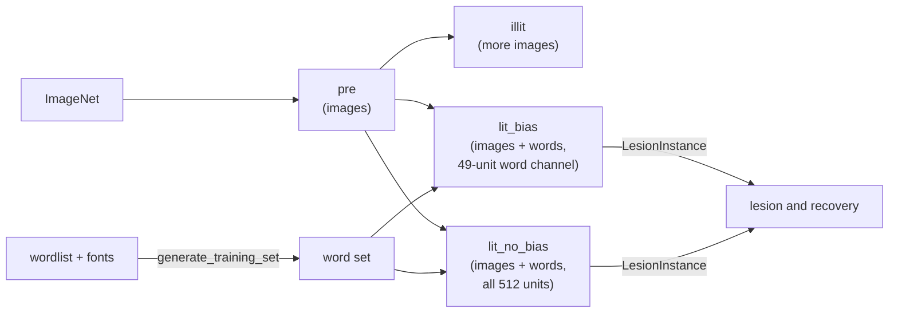

# CORread

[](https://github.com/vk4444/CORread/actions/workflows/ci.yml)
[](https://vk4444.github.io/CORread)
[](LICENSE)


**Train models of the ventral visual stream to read, and study the word-selective units that emerge.**

Learning to read repurposes part of the brain's object recognition system: a patch of ventral occipito-temporal cortex, the visual word form area, becomes selective for written words. Hannagan et al. (2021) reproduced this "neuronal recycling" in a convolutional network of the ventral stream, CORnet-Z: trained first on images and then on images and words together, the network develops a small set of word-selective units with a compositional code for letters and their positions.

CORread turns that experiment into a reproducible, extensible library. It generates the word stimuli, trains pre-literate, illiterate and literate CORnet-Z and CORnet-S networks, measures word selectivity in their dense layer, and lesions word-selective units to study how reading recovers. Every output records exactly how it was made.



## Features

- **Reproducible stimuli.** Word sets are drawn from a single seed and recorded as a *recipe* (seed, settings, wordlist and font hashes, per-folder image checksums), from which they can be regenerated byte for byte.
- **The training regimes of Hannagan et al.** Pre-literate training on ImageNet, then illiterate training (images only) or literate training (images and words) with a *biased* readout, where words can only read the last 49 dense-layer units, or an *unbiased* one. `FamilyTrainingInstance` trains all four from one pre-literate model.
- **CORnet-Z and CORnet-S**, the feedforward and the recurrent ventral-stream networks, on one or several GPUs.
- **Resumable, fully recorded runs.** Ctrl+C stops cleanly and `resume=True` continues from the last checkpoint. Each model's `metadata.json` records its arguments, seed, data (with hashes), code version and environment, and the validation of the starting weights and of every epoch.
- **Word selectivity and lesions.** Rank the dense-layer units by word selectivity, lesion any of them (once, or silenced for a number of epochs first), and track how accuracy and selectivity recover.
- **Sharing.** Optional export of models and word set recipes to a Hugging Face organisation of your own, with generated model cards that link each model to the model and data it came from.
- **Live status reports.** Optional status reports to a web API of your own, following a documented [API contract](docs/reporting.md) with a JSON Schema.

## Installation

```bash
pip install "corread @ git+https://github.com/vk4444/CORread"
# with Hugging Face sharing and ImageNet preparation:
pip install "corread[hub,imagenet] @ git+https://github.com/vk4444/CORread"
```

CORread needs Python 3.10 or newer and PyTorch 2.6 or newer. Install the PyTorch build for your hardware first if you want something other than the default from PyPI.

## What you provide

CORread contains no data. You provide, in folders listed in a `paths.toml` (see [`examples/paths.example.toml`](examples/paths.example.toml)):

- **Fonts** (`.ttf`) to draw the words in. Fonts are often licensed and are not distributed with CORread; any TrueType font works, e.g. the open DejaVu, Liberation or Noto fonts.
- **A wordlist**: a text file with one word per line.
- **ImageNet** (ILSVRC 2012), downloaded from <https://image-net.org> under its terms; `corread.prepare_imagenet()` unpacks the archives into the folders training reads.

## Quick start

```python
import corread
from corread import LesionInstance

# 1000 words x (1000 training + 50 validation images); validation uses a font not seen in training
corread.generate_training_set('english', 'english', train_fonts=['DejaVuSans', 'LiberationSerif'],
                              val_fonts=['NotoSans'], workers=16)

# pre-literate CORnet-Z on ImageNet, then the illiterate, unbiased and biased literate models from it
corread.FamilyTrainingInstance(model_choice='z', wordset='english').train()

# which dense-layer units of the biased model respond selectively to words, and what happens without them
selectivity = LesionInstance.word_selectivity('english/lit_bias_z_79')
LesionInstance('english/lit_bias_z_79', units=selectivity['selective_units'], max_epochs=10).train()
```

Each run writes its own folder under `models/`; see [Training](docs/training.md) for the layout and every option, and [`examples/`](examples) for complete scripts.

## Documentation

The documentation is at <https://vk4444.github.io/CORread>, and in [`docs/`](docs):
[getting started](docs/getting-started.md) ·
[stimuli](docs/stimuli.md) ·
[training](docs/training.md) ·
[lesions](docs/lesions.md) ·
[sharing on the Hub](docs/hub.md) ·
[reporting API](docs/reporting.md).

## Project status

| Part | Status |
|---|---|
| Word stimuli and word sets | stable |
| Training modes `pre`, `illit`, `lit_bias`, `lit_no_bias` (CORnet-Z and CORnet-S) | stable |
| Word selectivity and lesions (CORnet-Z) | beta |
| Hugging Face sharing, status reports | beta |

CORread is research software, developed alongside ongoing experiments; interfaces may still change before version 1.0.

## Citing

If you use CORread, please cite it (GitHub's "Cite this repository" button uses [`CITATION.cff`](CITATION.cff)), together with the work it builds on:

- Hannagan, T., Agrawal, A., Cohen, L., & Dehaene, S. (2021). Emergence of a compositional neural code for written words: Recycling of a convolutional neural network for reading. *PNAS*, 118(46), e2104779118. <https://doi.org/10.1073/pnas.2104779118>
- Kubilius, J., Schrimpf, M., Nayebi, A., Bear, D., Yamins, D. L. K., & DiCarlo, J. J. (2018). CORnet: Modeling the neural mechanisms of core object recognition. *bioRxiv* 408385. <https://doi.org/10.1101/408385>
- Kubilius, J., Schrimpf, M., Kar, K., et al. (2019). Brain-like object recognition with high-performing shallow recurrent ANNs. *NeurIPS 32*. <https://arxiv.org/abs/1909.06161>

## Credits

CORread was designed and written by **Vojtěch Kubala**. It grew out of a line of code that each step adapted from the one before:

1. **CORnet** by Jonas Kubilius, Martin Schrimpf and colleagues in the DiCarlo Lab at MIT ([dicarlolab/CORnet](https://github.com/dicarlolab/CORnet), GPL-3.0): the CORnet-Z and CORnet-S architectures.
2. **Origins-of-VWFA** by Théo Hannagan, Aakash Agrawal, Laurent Cohen and Stanislas Dehaene ([THANNAGA/Origins-of-VWFA](https://github.com/THANNAGA/Origins-of-VWFA), GPL-3.0): the literacy training paradigm, the biased and unbiased readouts, and the original training code.
3. **Dr. Olga Solaja**'s adaptation of the Origins-of-VWFA code, from which this library was developed.

On that basis, CORread adds the reproducible stimulus pipeline, resumable and provenance-tracked training, CORnet-S support, family training, the word selectivity and lesion experiments, Hugging Face sharing and status reporting. [`NOTICE`](NOTICE) lists which files derive from which source.

## License

CORread is free software under the [GNU General Public License v3.0 or later](LICENSE), the license of the code it derives from.
